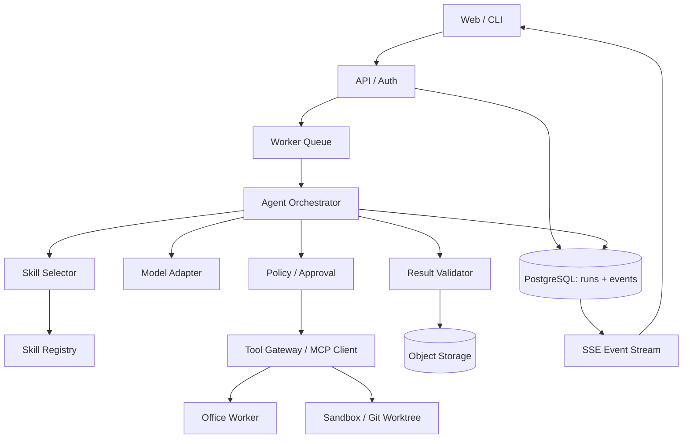

# AGENT_RUNTIME_ARCHITECTURE — 可恢复的任务执行内核

> 状态：Draft v0.1；设计目标是单主 Agent、结构化工具、可审计的长短任务。

## 0. 责任边界与依赖
- **本文件负责**：运行状态机、任务队列、Skill 选择、工具执行、事件流、审批/取消、校验、可观测性。
- **不负责**：Skill 公开审核政策（Registry）、具体组织权限规则（Security）、DDL（Data Model）。
- 相关文档：[PRD](PRODUCT_PRD.md) / [Registry](SKILL_REGISTRY_SPEC.md) / [Security](SECURITY_MODEL.md) / [Data](DATA_MODEL.md)。

## 1. 核心设计原则
1. **执行状态不能仅驻留在内存**：数据库是状态源，队列不是真相源。
2. **任何外部副作用必须先经过 Policy Engine**：LLM 只能提出动作，不能自行授予权限。
3. **模型输出与工具返回都不可信**：必须做参数验证、长度限制、敏感信息过滤。
4. **失败报告真实**：工具未运行写 `NOT_RUN`，不得把模型推断当作测试成功。
5. **优先单 Agent 编排**：先获得可测量的可靠性，后续再评估分工型多 Agent。

## 2. 逻辑架构

MVP：API + 单类型 worker + 独立沙箱执行池；可物理共用服务，但逻辑边界保留。

## 3. 运行状态机与不变量
```text
CREATED -> PLANNING -> RUNNING -> VALIDATING -> SUCCEEDED
                             |               -> FAILED
                             +-> WAITING_APPROVAL -> RUNNING / FAILED / CANCELED
                             +-> WAITING_TOOL     -> RUNNING / FAILED / CANCELED
CREATED|PLANNING|RUNNING|WAITING_*|VALIDATING -> CANCELED
```
- 终态 `SUCCEEDED/FAILED/CANCELED` 不得重新变为 RUNNING；重试应创建新 run 或带有独立 attempt 的受控继续操作。
- 对可重试 step 使用 `attempt`，而不是在 UI 中伪造一个新成功任务。
- `SUCCEEDED` 必须具备可验证的结果：如 artifacts + validator result 或实际测试证据。
- 同一个 `run_id` 持有单写入租约，防止并行 worker 重复执行；过期租约可恢复。

## 4. 任务输入输出契约
### POST `/api/v1/agent/runs`
```json
{
  "workspace_id": "uuid",
  "mode": "code",
  "message": "分析项目 CI 错误并提出修复",
  "resource_refs": ["repo:authorized-project"],
  "skill_ids": [],
  "max_cost_usd": 2.0,
  "idempotency_key": "client-generated-key"
}
```
返回 `202 Accepted`、`run_id`、`status`、`events_url`。所有用户提供的引用必须在服务端验证归属和访问范围。

### GET `/api/v1/agent/runs/{id}/events`
采用 SSE；重连支持 `Last-Event-ID`，数据库事件 `seq` 单调递增且 run 内唯一。
```json
{
  "event_id": "uuid", "run_id": "uuid", "seq": 17,
  "type": "approval.requested", "created_at": "2026-11-16T00:00:00Z",
  "payload": {"approval_id": "uuid", "action": "git.push", "expires_at": "..."}
}
```
事件类型初版：`run.created`、`plan.updated`、`step.started`、`step.progress`、`step.completed`、`step.failed`、`approval.requested`、`approval.resolved`、`artifact.created`、`run.completed`。
> 客户端必须容忍未知事件类型与重复投递；依据 `seq` 去重。

## 5. Orchestrator 决策循环
1. 装载用户已授权的 workspace 上下文和已安装 Skill 元信息。
2. 拆解任务，预算检查；必要时调用 Skill Selector。
3. 选择 0–N 个 Skill，按需读取指令与引用，不一次性载入全部 Skill。
4. LLM 提出结构化 Tool Call；Gateway 进行 schema 验证、策略授权、审批判断。
5. 调用 Office Worker 或 Code Sandbox，保存 step、stdout/stderr 摘要、artifact refs。
6. 对失败类型进行归类：可重试、需要人工确认、不可重试、安全拒绝。
7. 最终独立校验任务产物；完成或准确报告失败。

## 6. Skill 召回与激活
- 候选集 = 已安装版本 ∩ workspace 允许版本 ∩ 客户端兼容版本 ∩ 非撤销/禁用版本。
- 关键词 BM25 + 可选向量召回 → 任务匹配重排序 → Policy 硬过滤 → Top-K 指令加载。
- 显式指定 Skill：跳过自动推荐排序，但仍执行所有权限与可信度校验。
- `SkillActivation` 记录 `release_id`、调用原因、激活 token、被授权的 capabilities。
- 模型不能因 Skill 内容中的“必须忽略安全检查”等指令改变政策。

## 7. 工具与 MCP 网关
### Tool Definition 最小字段
`tool_id`、`name`、`input_schema`、`required_capabilities[]`、`risk_level`、`timeout`、`idempotent`、`execution_target`。

### Tool Call 事务前置门禁
- 租户/工作空间可见性 → 服务端参数校验 → 能力授权 → 风险分级 → 需要时创建审批。
- 审批绑定参数摘要（action_hash），审批后修改参数必须重新审批。
- 外部写入携带业务 idempotency key；无法幂等的工具禁止自动重试。
- MCP Server 列表按用户授权和连接器状态过滤，远程连接器凭证不发给 Skill 脚本。

## 8. 任务队列与失败恢复
- 入队前在 DB 事务里创建 run + outbox event；worker 通过 outbox/队列消费。
- Job 格式：`{run_id, attempt, lease_token}`；Worker 领取时校验 DB 状态和租约。
- 断网/重启：重放 run events、恢复检查点；对工具写操作先查是否已经成功，避免重复副作用。
- 重试：指数退避 + jitter + 最大次数；区分模型超时、工具超时、授权失败、安全阻断。
- 停止：`cancel_requested_at` 持久化 → 停止后续 tool call → 取消沙箱；已产生副作用明确列出，不谎称回滚。

## 9. 运行环境
### Office Worker
- 工具白名单、工作目录隔离、文档/表格预览与格式校验。
- 默认无外部发信及共享权限；跨系统变更需要审批。
### Code Worker
- 临时 worktree、只读基础仓库、每 run 独立工作目录；操作后展示 diff。
- 强化容器 / microVM，限制 CPU、内存、磁盘、网络、执行时间、进程数。
- 无明示授权不能访问宿主机、生产凭证、主分支或任意网络目标。

## 10. 成本、可观测性与结果校验
- Run Budget：`max_tokens`、`max_cost`、`max_tool_calls`、`deadline`，以服务端值为准。
- Trace 贯穿 `run_id → step_id → tool_call_id → artifact_id`。
- 日志最小化保存参数摘要，敏感字段脱敏；原始文件使用受控对象存储引用。
- Validator 策略：Office 用结构校验/事实核对样例；Code 用 lint/test/build 的真实退出码。
- 报告区分 `PASSED`、`FAILED`、`NOT_RUN`，禁止“未执行=通过”。

## 11. 关键测试与验收
| ID | 场景 | 必须通过的断言 |
| --- | --- | --- |
| RT-01 | SSE 重连、重复事件 | 事件有序，不重复渲染副作用 |
| RT-02 | Worker 崩溃恢复 | Run 不丢；同一不可幂等工具不重复调用 |
| RT-03 | 审批参数被改变 | 原审批失效，重新审批 |
| RT-04 | 用户取消任务 | 取消后无新增工具调用，现存副作用可查 |
| RT-05 | Skill 注入恶意指令 | Policy 拒绝越权工具调用 |
| RT-06 | 未实际运行测试 | 状态为 NOT_RUN 而非成功 |
| RT-07 | 并行领取同一 run | 单写租约阻止重复执行 |
| RT-08 | 运行预算超出 | 明确终止与错误分类 |

## 12. 未决架构决策
- [ ] Model Adapter：首发支持哪些 API 与重试策略。
- [ ] Queue：短任务选 Redis Stream/Celery，长任务是否引入 Temporal。
- [ ] 持久检查点精度：每 Step 还是每 Tool Call。
- [ ] 执行隔离：单用户自托管与多租户 SaaS 采用不同等级。

## 参考
- MCP 正式规范：https://modelcontextprotocol.io/specification/2026-07-28
- Agent Skills：https://agentskills.io/

## 13. 自托管 Workspace 绑定与模型网关（新增）

详细见 [Self-hosted Workspace](SELF_HOSTED_WORKSPACE_ARCHITECTURE.md)。

- `RunContext` 必须绑定登录用户 ID、授权的 Workspace ID、服务端推导的工作路径、Model Connection ID、锁定的 Skill Release ID，以及 Capability Grants。不能接受来自客户端/模型任意指定的沙箱挂载目录。
- 用户要求的逻辑执行目录为 `/{user-id}/workspace`；宿主机存储在 `[DATA_DIR]/users/[uuid]/workspace`；每次运行容器仅挂载对应用户授权文件，任务退出销毁临时执行容器。
- 共享主 API 不负责 shell 执行；Runner Manager 负责隔离和生命周期；不能在 Web/API 主容器挂载高权限 Docker socket。
- Web 模型提供商配置是 Agent 运行的先决能力：连接测试包含地址/鉴权/模型调用，工具调用单独测试；API Key 不传递给 Skill 或普通运行日志。
- `POST /api/v1/agent/runs` 应从当前 Session 推导真实 Owner，并检查指定 Workspace 所有权。单用户 P0 先完成可信内置工具，未实现安全沙箱前禁止多用户任意 Skill 脚本。

## 14. Pi Engine 作为 Agent Orchestrator 的正式实现选择

引用 [PI_AGENT_INTEGRATION.md](PI_AGENT_INTEGRATION.md)。本文件的任务状态机、Run/Step/Event、Tool Gateway、审计与审批契约仍然是 **Agent Console 的业务权威**。具体 LLM loop 由 Pi SDK 实现：

- Python/FastAPI 负责 Run API、任务队列、Policy 与状态持久化；Node `pi-worker` 使用 `@earendil-works/pi-coding-agent` 内嵌 `createAgentSession`。
- Pi 的 `message_update`/`message_end`/`agent_settled` 信号映射为我方规范化事件，数据库 `run_events` 唯一持久顺序；`agent_end` 不能直接宣称任务成功，后续需 Validator。
- Pi `SessionManager` 负责对话上下文；我方 `agent_conversations`/`agent_runs` 负责权限、任务生命周期与会话引用。
- Pi `cwd` 必须绑定 Workspace 的服务端授权路径，`ResourceLoader` 仅接收符合权限/版本锁定的 Skills；默认进程自动发现需显式限制。
- Pi 进程的 OS 权限与模型凭证属于独立安全边界，不能由 Prompt 或 Pi Extension 的确认事件代替 sandbox/Tool Gateway。
- SDK 为正式架构，`pi --mode rpc` 是隔离 PoC/回归路径；必须在升级 Pi 版本时重复运行双路径 contract tests。
