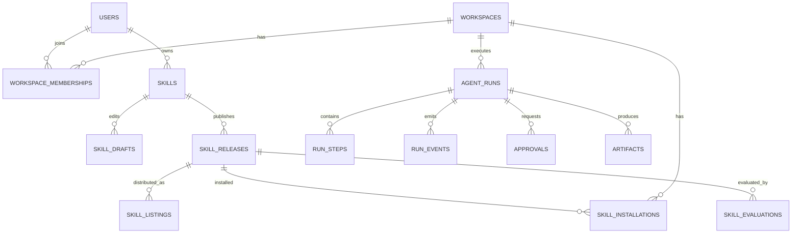

# DATA_MODEL — 数据实体、约束、Schema 与演进

> 状态：Draft v0.1。使用 PostgreSQL 作为业务真相源，MinIO/S3 存二进制内容，Redis/Queue 仅存派生状态。

## 0. 文档边界
- **负责**：领域实体、关系、关键索引、迁移、事件一致性、数据保留。
- **不负责**：模型 Prompt、前端样式与沙箱进程控制。
- 关联：[Runtime](AGENT_RUNTIME_ARCHITECTURE.md) / [Registry](SKILL_REGISTRY_SPEC.md) / [Security](SECURITY_MODEL.md)。

## 1. 核心关系


## 2. 规范化数据关系
| 表 | 说明 | 主键 / 唯一约束 |
| --- | --- | --- |
| users | 账号、用户状态 | id, identity 唯一 |
| organizations | 企业租户 | id, slug 唯一 |
| workspaces | 个人或组织工作空间 | id, 关联 owner_user/org |
| workspace_memberships | 人在 workspace 的角色 | (workspace_id,user_id) |
| skills | 技能长期身份、作者及来源 | id, (owner_user_id,slug) |
| skill_drafts | 可变草稿与对象存储引用 | id, skill_id+revision |
| skill_releases | 不可变版本及包摘要 | id, (skill_id,version) |
| skill_listings | 版本对特定范围分发 | id, scope+owner target+skill 业务唯一策略 |
| skill_installations | 工作空间安装固定 release | (workspace_id,skill_id) 单活安装 |
| skill_evaluations | 版本评测证据 | id, release_id+suite_digest |
| agent_runs | 任务状态、预算、租约 | id, workspace+idempotency_key |
| run_steps | 模型/工具/验证步骤 | id, run_id+step_index+attempt |
| run_events | 事件日志、SSE 可恢复 | id, (run_id,seq) |
| approvals | 参数绑定的操作审批 | id, action_hash |
| capability_grants | 用户、workspace、资源权限 | id, scope+有效期 |
| artifacts | Run 产物及摘要 | id, object_key |
| audit_events | 不可覆盖的业务安全事件 | id，按时间分区可选 |
| outbox_events | 与业务变更同事务的投递源 | id，消费端处理幂等 |

## 3. PostgreSQL 初版 DDL（设计草案）
> 以下为可执行方向的**基线结构**，不是已经完成的迁移。生产迁移仍需补充扩展枚举、索引规划、RLS、防删除约束和多阶段兼容变更测试。`gen_random_uuid()` 依赖可用的 PostgreSQL UUID 生成能力。

```sql
CREATE TABLE users (
  id uuid PRIMARY KEY DEFAULT gen_random_uuid(),
  identity text NOT NULL UNIQUE,
  status text NOT NULL DEFAULT 'active'
    CHECK (status IN ('active','disabled')),
  created_at timestamptz NOT NULL DEFAULT now()
);
CREATE TABLE organizations (
  id uuid PRIMARY KEY DEFAULT gen_random_uuid(),
  slug text NOT NULL UNIQUE, name text NOT NULL,
  created_at timestamptz NOT NULL DEFAULT now()
);
CREATE TABLE workspaces (
  id uuid PRIMARY KEY DEFAULT gen_random_uuid(),
  name text NOT NULL,
  owner_user_id uuid REFERENCES users(id),
  org_id uuid REFERENCES organizations(id),
  mode text NOT NULL DEFAULT 'general'
    CHECK (mode IN ('general','office','code')),
  created_at timestamptz NOT NULL DEFAULT now(),
  CHECK ((owner_user_id IS NOT NULL) <> (org_id IS NOT NULL))
);
CREATE TABLE workspace_memberships (
  workspace_id uuid NOT NULL REFERENCES workspaces(id),
  user_id uuid NOT NULL REFERENCES users(id),
  role text NOT NULL CHECK (role IN ('member','admin')),
  PRIMARY KEY (workspace_id,user_id)
);
CREATE TABLE skills (
  id uuid PRIMARY KEY DEFAULT gen_random_uuid(),
  owner_user_id uuid NOT NULL REFERENCES users(id),
  origin_skill_id uuid REFERENCES skills(id),
  slug text NOT NULL, title text NOT NULL,
  created_at timestamptz NOT NULL DEFAULT now(),
  UNIQUE(owner_user_id,slug)
);
CREATE TABLE skill_drafts (
  id uuid PRIMARY KEY DEFAULT gen_random_uuid(),
  skill_id uuid NOT NULL REFERENCES skills(id),
  revision integer NOT NULL CHECK (revision > 0),
  content_object_key text NOT NULL,
  updated_at timestamptz NOT NULL DEFAULT now(),
  UNIQUE(skill_id,revision)
);
CREATE TABLE skill_releases (
  id uuid PRIMARY KEY DEFAULT gen_random_uuid(),
  skill_id uuid NOT NULL REFERENCES skills(id),
  version text NOT NULL,
  package_sha256 text NOT NULL CHECK (package_sha256 ~ '^[a-f0-9]{64}$'),
  package_object_key text NOT NULL,
  manifest jsonb NOT NULL,
  security_status text NOT NULL DEFAULT 'validated'
    CHECK (security_status IN ('validated','quarantined','revoked')),
  created_at timestamptz NOT NULL DEFAULT now(),
  UNIQUE(skill_id,version),
  UNIQUE(id,skill_id)
);
CREATE TABLE skill_listings (
  id uuid PRIMARY KEY DEFAULT gen_random_uuid(),
  skill_id uuid NOT NULL REFERENCES skills(id),
  release_id uuid NOT NULL,
  workspace_id uuid REFERENCES workspaces(id),
  scope text NOT NULL CHECK (scope IN ('private','workspace','public')),
  status text NOT NULL CHECK (status IN
    ('pending_review','published','rejected','unlisted','suspended')),
  approved_by uuid REFERENCES users(id),
  created_at timestamptz NOT NULL DEFAULT now(),
  CHECK ((scope='public' AND workspace_id IS NULL) OR
         (scope IN ('private','workspace') AND workspace_id IS NOT NULL)),
  CHECK (scope <> 'public' OR status <> 'published' OR approved_by IS NOT NULL),
  FOREIGN KEY (release_id,skill_id) REFERENCES skill_releases(id,skill_id)
);
CREATE TABLE skill_installations (
  id uuid PRIMARY KEY DEFAULT gen_random_uuid(),
  workspace_id uuid NOT NULL REFERENCES workspaces(id),
  skill_id uuid NOT NULL REFERENCES skills(id),
  release_id uuid NOT NULL,
  enabled boolean NOT NULL DEFAULT false,
  created_at timestamptz NOT NULL DEFAULT now(),
  UNIQUE(workspace_id,skill_id),
  FOREIGN KEY (release_id,skill_id) REFERENCES skill_releases(id,skill_id)
);
CREATE TABLE skill_evaluations (
  id uuid PRIMARY KEY DEFAULT gen_random_uuid(),
  release_id uuid NOT NULL REFERENCES skill_releases(id),
  suite_digest text NOT NULL,
  result text NOT NULL CHECK (result IN ('passed','failed','not_run')),
  evidence_object_key text,
  created_at timestamptz NOT NULL DEFAULT now(),
  UNIQUE(release_id,suite_digest)
);
CREATE TABLE agent_runs (
  id uuid PRIMARY KEY DEFAULT gen_random_uuid(),
  workspace_id uuid NOT NULL REFERENCES workspaces(id),
  created_by uuid NOT NULL REFERENCES users(id),
  mode text NOT NULL CHECK (mode IN ('general','office','code')),
  status text NOT NULL DEFAULT 'created'
    CHECK (status IN ('created','planning','running','waiting_approval',
       'waiting_tool','validating','succeeded','failed','canceled')),
  idempotency_key text NOT NULL,
  cost_limit_usd numeric(12,4) NOT NULL CHECK (cost_limit_usd >= 0),
  lease_owner text, lease_expires_at timestamptz,
  cancel_requested_at timestamptz,
  created_at timestamptz NOT NULL DEFAULT now(),
  updated_at timestamptz NOT NULL DEFAULT now(),
  UNIQUE(workspace_id,idempotency_key)
);
CREATE TABLE run_steps (
  id uuid PRIMARY KEY DEFAULT gen_random_uuid(),
  run_id uuid NOT NULL REFERENCES agent_runs(id),
  step_index integer NOT NULL CHECK (step_index >= 0),
  attempt integer NOT NULL DEFAULT 1 CHECK (attempt >= 1),
  kind text NOT NULL,
  status text NOT NULL CHECK (status IN
    ('queued','running','succeeded','failed','skipped','not_run')),
  result_object_key text,
  created_at timestamptz NOT NULL DEFAULT now(),
  UNIQUE(run_id,step_index,attempt)
);
CREATE TABLE run_events (
  id uuid PRIMARY KEY DEFAULT gen_random_uuid(),
  run_id uuid NOT NULL REFERENCES agent_runs(id),
  seq bigint NOT NULL CHECK (seq >= 0),
  type text NOT NULL, payload jsonb NOT NULL,
  created_at timestamptz NOT NULL DEFAULT now(),
  UNIQUE(run_id,seq)
);
CREATE TABLE approvals (
  id uuid PRIMARY KEY DEFAULT gen_random_uuid(),
  run_id uuid NOT NULL REFERENCES agent_runs(id),
  requested_by uuid NOT NULL REFERENCES users(id),
  decided_by uuid REFERENCES users(id),
  action_name text NOT NULL,
  action_hash text NOT NULL,
  status text NOT NULL CHECK (status IN ('pending','approved','denied','expired')),
  expires_at timestamptz NOT NULL,
  decided_at timestamptz
);
CREATE TABLE capability_grants (
  id uuid PRIMARY KEY DEFAULT gen_random_uuid(),
  workspace_id uuid NOT NULL REFERENCES workspaces(id),
  principal_user_id uuid NOT NULL REFERENCES users(id),
  capability text NOT NULL, resource_scope jsonb NOT NULL,
  expires_at timestamptz, revoked_at timestamptz,
  created_at timestamptz NOT NULL DEFAULT now()
);
CREATE TABLE artifacts (
  id uuid PRIMARY KEY DEFAULT gen_random_uuid(),
  run_id uuid NOT NULL REFERENCES agent_runs(id),
  object_key text NOT NULL UNIQUE,
  sha256 text NOT NULL,
  mime_type text NOT NULL,
  created_at timestamptz NOT NULL DEFAULT now()
);
CREATE TABLE audit_events (
  id uuid PRIMARY KEY DEFAULT gen_random_uuid(),
  workspace_id uuid REFERENCES workspaces(id),
  actor_user_id uuid REFERENCES users(id),
  action text NOT NULL, target_type text NOT NULL, target_id uuid,
  evidence_object_key text,
  created_at timestamptz NOT NULL DEFAULT now()
);
CREATE TABLE outbox_events (
  id uuid PRIMARY KEY DEFAULT gen_random_uuid(),
  event_type text NOT NULL, aggregate_id uuid NOT NULL,
  payload jsonb NOT NULL,
  published_at timestamptz,
  created_at timestamptz NOT NULL DEFAULT now()
);
CREATE INDEX idx_runs_workspace_time ON agent_runs(workspace_id,created_at DESC);
CREATE INDEX idx_listings_scope_status ON skill_listings(scope,status);
CREATE UNIQUE INDEX uniq_open_listing_per_target ON skill_listings
  (skill_id,scope,COALESCE(workspace_id,'00000000-0000-0000-0000-000000000000'::uuid))
  WHERE status IN ('pending_review','published');
CREATE INDEX idx_releases_skill_time ON skill_releases(skill_id,created_at DESC);
```

## 4. 不能只靠 DDL 实现的关键不变量
1. `skill_listings.release_id` 和 `skill_installations.release_id` 必须属于相同 `skill_id`：基线 DDL 已用复合外键保证。
2. 安装仍须校验有合法 listing 或本人私有版本，以及调用者的可见性；外键不能表达业务权限。
3. `skill_releases` 内容不可原地 UPDATE（使用 DB trigger/权限禁止修改 digest、包、version）。
4. `public pending_review → published` 必须有审核记录和审核员授权；DDL 检查 `approved_by` 非空，审批员资格需由服务端核对。
5. 私有 listing 的 `workspace_id` 必须属于所有者可访问的私人 workspace。
6. 对象存储键不代表访问权限；下载必须重新校验 actor/workspace。
7. `run_events.seq` 按 run 单调生成，避免简单 `MAX(seq)+1` 并发竞争；采用锁/独立计数器。
8. `audit_events` 防篡改：普通 API 无 UPDATE/DELETE 权限；可用专用审计存储强化。

## 5. 数据访问与索引策略
- 每一个 workspace 资源查询必须带 workspace 范围；管理员跨租户操作通过单独审计入口。
- PostgreSQL Row Level Security 可作第二防线，但不能替代 API 授权校验。
- `skills` 发现：仅对可见 listing 的 `name/description/tags` 建 FTS；向量索引是 P2 选项。
- 对数据生命周期：run events/trace、artifacts 和审计的保留期限分开；压缩归档不改变可追溯性。
- 上传包以 SHA-256 内容寻址；MinIO/S3 对象读写只能由授权服务发签名 URL。

## 6. 数据迁移策略
- 迁移文件按编号不可覆盖，如 `0001_initial.sql`、`0002_listing_constraints.sql`。
- 先增加可兼容字段/索引 → 回填 → 新旧版本双读/切换 → 删除旧字段；避免停机变更。
- 每次迁移测试：新库初始化、旧库升级、降级策略或备份恢复、并发写和唯一约束冲突。
- 版本回滚不是直接覆盖旧 release，而是切换 listing 指向已有可用 release 并写审计。

## 7. 测试矩阵
| ID | 场景 | 通过条件 |
| --- | --- | --- |
| DB-01 | 同 `skill_id/version` 不同包 | 唯一约束拒绝且原摘要不变 |
| DB-02 | Listing 指错 Skill 的 Release | 拒绝，事务回滚 |
| DB-03 | 跨 Workspace 读取 Run/Artifact | 403/404，不泄露记录 |
| DB-04 | 多 Worker 争抢租约 | 只有一个持有有效写租约 |
| DB-05 | 同 run 并行写 events | seq 唯一、有序、可重放 |
| DB-06 | DB commit 后队列宕机 | Outbox 重试后任务最终可处理 |
| DB-07 | Unlist 与 Install 并发竞态 | 不允许产生无资格新安装 |
| DB-08 | 审计事件写入后 API 修改 | 应用用户无法变更或删除 |

## 8. 待决策
- [ ] PostgreSQL 主版本与 UUID 函数/扩展策略。
- [ ] 是否从第一天启用 RLS、如何组织运维账号绕过规则与审计。
- [ ] 私人 workspace 的共享和数据迁移策略。
- [ ] 对象存储版本保留与垃圾回收周期。

## 9. 自托管模型连接与本地工作区补充 Schema（新增）

参见 [Self-hosted Workspace](SELF_HOSTED_WORKSPACE_ARCHITECTURE.md)。下列 DDL 是**设计草案，未在 PostgreSQL 执行**。存储目录依赖服务端 UUID 推导，严禁保存来自客户端的可任意挂载路径。

```sql
CREATE TABLE model_connections (
  id uuid PRIMARY KEY DEFAULT gen_random_uuid(),
  owner_user_id uuid REFERENCES users(id),
  scope text NOT NULL CHECK (scope IN ('deployment','user')),
  protocol text NOT NULL CHECK (protocol IN ('openai_chat','openai_responses','ollama','native')),
  name text NOT NULL,
  base_url text NOT NULL,
  encrypted_secret_ref text,
  enabled boolean NOT NULL DEFAULT true,
  created_at timestamptz NOT NULL DEFAULT now(),
  CHECK ((scope = 'user' AND owner_user_id IS NOT NULL)
      OR (scope = 'deployment' AND owner_user_id IS NULL))
);
CREATE TABLE model_aliases (
  id uuid PRIMARY KEY DEFAULT gen_random_uuid(),
  connection_id uuid NOT NULL REFERENCES model_connections(id),
  external_model_id text NOT NULL,
  display_name text NOT NULL,
  tool_calling_status text NOT NULL DEFAULT 'untested'
    CHECK (tool_calling_status IN ('untested','passed','failed')),
  UNIQUE (connection_id,external_model_id)
);
```

所有 owner 作用域通过服务端授权读取，DB 数据存在也不意味着已完成行级安全隔离。密钥引用需关联实际加密秘密存储（含轮换/备份策略）。工作区实体沿用现有 `workspaces.owner_user_id`，磁盘路径使用 `[DATA_DIR]/users/[owner_uuid]/workspace`，不要加入可被篡改的绝对路径作为授权来源。
