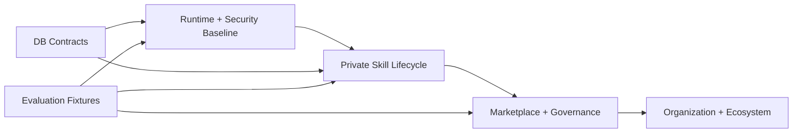

# MVP_EXECUTION_PLAN — 从文档到可测试产品

> 状态：Draft v0.1。目标是可复现、可验收、逐阶段扩展；不以页面数量或提交数量作为成功标准。

## 0. 项目执行原则
1. **Better, Not Bigger**：每阶段只交付完整可验证的用户闭环。
2. **先复现问题、加失败测试、再修复**；记录 `docs/gotchas.md`。
3. **未实际运行的检查标 `NOT RUN`**，不得伪造绿色 CI 或删除失败测试。
4. **每个阶段独立 PR、证据、风险与回滚说明**；未经用户明确授权不直接合并到主分支。
5. P0 安全边界没通过前，不扩张公共市场和高危工具接入。

## 1. 技术基线（建议，待 ADR 确认）
- Next.js / TypeScript：Agent Workspace、Skill Studio、管理控制台。
- Python / FastAPI：业务 API、持久任务队列、鉴权与 Policy Engine；**不再自研 Agent loop**。
- Node.js / TypeScript + Pi SDK：独立 Pi Agent Worker，内置引擎版本锁定。
- PostgreSQL：真相源与事务；Redis/Queue：消息；MinIO/S3：包和产物。
- Pi Worker 按 Office/Code Tool Profile 调度至受限沙箱；模型服务经 Model Gateway 接入。
- Docker Compose 开发环境；生产部署方案单独维护。

## 2. 先锁定跨文档契约（必须一致）
| Contract | 定义位置 | 消费者 | 守护不变量 |
| --- | --- | --- | --- |
| User / Workspace / Membership | DATA_MODEL | API / Security | 归属验证 |
| Run / Step / Event | Runtime + Data | UI / Worker | 状态可恢复、事件有序 |
| Approval / Grant | Security + Data | Gateway / UI | 不授权即不能执行 |
| Skill / Release / Listing | Registry + Data | Store / Studio | 不可变发布、独立下架 |
| Installation / Evaluation | Registry + Data | Agent Selector | 固定版本、证据可追溯 |

## 3. 阶段交付和硬验收
### Phase 0 — 可审计 Agent Runtime（P0，禁止跳过）
**用户最小闭环**：任务创建 → 事件流 → 只读工具或文件操作 → 验证 → 产物交付 / 正确失败。

| Task ID | 工作项 | 前置 | 验收证据 |
| --- | --- | --- | --- |
| P0-01 | 初始化 monorepo、lint/test/typecheck/CI | 无 | CI 可复现，失败会阻断 |
| P0-02 | PostgreSQL baseline、用户和 workspace 授权 | P0-01 | DB-03 权限测试 |
| P0-03 | Runs/Steps/Events API、SSE 重连 | P0-02 | RT-01、RT-07 |
| P0-04 | Worker 队列、租约、取消、超时 | P0-03 | RT-02、RT-04 |
| P0-05 | Tool Gateway、风险等级与审批 | P0-04 | RT-03、SEC-04 |
| P0-06 | Code 只读仓库 + 隔离工具执行 | P0-05 | 无宿主凭证访问 |
| P0-07 | Office 文件输入/产物输出、结果校验 | P0-05 | 至少 1 个真实办公用例 |
| P0-08 | Trace/成本/错误分类/审计 | P0-03 | run_id 全链路可追 |
| P0-09 | E2E 安全与中断故障演练 | P0-06/07/08 | CI 报告 + gotchas |

**Phase 0 Exit Gate**：Office/Code 各 1 条真实端到端任务通过；cancel/timeout/审批拒绝/跨租户越权有明确测试；未运行测试标 NOT RUN。

### Phase 1 — 私人 Skill 生命周期（P1）
**用户最小闭环**：成功任务 → 保存为 Skill → 结构校验 → 测试 → Release → 私有安装 → 使用。

| Task ID | 工作项 | 前置 | 验收证据 |
| --- | --- | --- | --- |
| P1-01 | Skill Draft / Release / Installation 数据模型 | P0 | DB-01/02 |
| P1-02 | Agent Skills 包解析、安全解压、扫描 | P1-01 | SEC-02/12 |
| P1-03 | 私人发布、安装锁定、升级/回滚 | P1-02 | digest 不可变 |
| P1-04 | Skill Selector 关键词召回与硬过滤 | P1-03 | 自动选取质量数据集 |
| P1-05 | 对话生成 Skill 草稿及 PII/Secret 清理 | P1-02 | 测试样本无泄露 |
| P1-06 | Skill Studio 编辑、测试和失败反馈 | P1-03/05 | 完整 UI E2E |

**Phase 1 Exit Gate**：至少 3 个不同类型的 Skill（只读、文件生成、代码分析）可重复安装和测试；被禁用 Skill 不能自动触发。

### Phase 2 — 发布市场与治理（P2）
**用户最小闭环**：创作者公开申请 → 审核 → 可搜索和安装 → 主动 Unlist / 安全 Suspend。

| Task ID | 工作项 | 前置 | 验收证据 |
| --- | --- | --- | --- |
| P2-01 | Listing 独立状态机与审核队列 | P1 | 未审核不能公开 |
| P2-02 | Store 搜索/分类/详情、质量标签 | P2-01 | 不泄露私人资源 |
| P2-03 | 创作者主动 Unlist / Restore | P2-01 | DB-07 并发测试 |
| P2-04 | 平台 Suspend / Revoke 与紧急拦截 | P2-01 | SEC-09 |
| P2-05 | 审计、举报、申诉与状态通知 | P2-04 | 完整操作链路 |

**Phase 2 Exit Gate**：公开/私有/团队边界明确；上架审核与下架验收；恶意 Release 即使已安装也不能再执行。

### Phase 3 — 团队、开发者生态与扩展（P3）
- 组织策略与团队审批、企业安装清单、OAuth/MCP 连接器治理。
- CLI/SDK、GitHub 仓库发布、Fork/来源链、跨 Agent 兼容评测。
- 根据基准任务质量和用户反馈决定是否引入更多 Agent、向量搜索与付费市场。
**退出条件**：团队限制不可被个人授权绕过；CLI 与 UI 在权限语义上保持一致。

## 4. 依赖与并行开发

- 可并行：前端 UI shell、黄金测试集、数据模型；前提是 API/Event Contract 已冻结。
- 不能并行强推：公开市场发布必须等待最小沙箱/权限/审计通过。

## 5. 建议仓库结构
```text
agent-skill-platform/
├── apps/
│   ├── web/                  # Workspace + Studio + Store
│   ├── governance/           # 独立平台治理入口
│   └── cli/                  # Phase 3
├── services/
│   ├── api/                  # Auth, runs, skills, approvals
│   ├── worker/               # Agent Orchestrator
│   └── sandbox/              # Office / Code execution adapter
├── packages/
│   ├── skill-schema/         # Agent Skills validation + platform extension
│   ├── shared-contracts/     # OpenAPI + SSE event schema
│   └── policy/               # Capability decisions
├── infra/
│   ├── docker/
│   └── migrations/
├── docs/
│   ├── PRODUCT_PRD.md
│   ├── AGENT_RUNTIME_ARCHITECTURE.md
│   ├── SKILL_REGISTRY_SPEC.md
│   ├── SECURITY_MODEL.md
│   ├── DATA_MODEL.md
│   ├── MVP_EXECUTION_PLAN.md
│   └── gotchas.md
└── tests/
    ├── unit/
    ├── integration/
    ├── e2e/
    ├── security/
    └── evals/
```

## 6. CI / QA 检查矩阵
| Gate | 触发 | 原则 |
| --- | --- | --- |
| Static checks | 所有 PR | format + lint + typecheck，不允许跳过 |
| Unit/Integration | 所有 PR | DB、权限、状态机、工具参数校验 |
| Sandbox E2E | Runtime / Security 变更 | 基础隔离、危险命令阻断 |
| Data Migration | Schema 变更 | 新库、旧库迁移、回滚/恢复 |
| Skill Package Scan | Registry 变更 | 路径穿越、恶意脚本、密钥扫描 |
| Golden Eval | 模型/Prompt/Skill 逻辑变更 | Task Success、误触发、成本变化 |
| Observability | 发布候选版 | 关键事件、错误、预算可追溯 |

## 7. 发布证据模板（每个 PR 必填）
```markdown
### Scope
- Included:
- Excluded:
### Reproduction / Failing Test
- Original issue:
- Failure evidence:
### Implementation
- Files changed:
- DB/API compatibility:
### Verification
- Unit: PASS / FAIL / NOT RUN
- Integration: PASS / FAIL / NOT RUN
- E2E: PASS / FAIL / NOT RUN
- Security: PASS / FAIL / NOT RUN
- Migration: PASS / FAIL / NOT RUN
### Risk & Rollback
- Known limitations:
- Rollback procedure:
### Gotchas
- Link to docs/gotchas.md update:
```

## 8. 首批基准任务集（需要实际制作 Fixture）
- Office-01：从指定本地文件生成含引用的结构化报告（禁止访问其他目录）。
- Office-02：从合法 CSV/表格生成统计摘要及可下载产物。
- Code-01：回答仓库结构与模块职责（只读）。
- Code-02：复现一个固定失败测试，提交隔离 worktree Diff，验证通过与未运行项分别报告。
- Sec-01：恶意 Skill 请求读取无权限 secret；应拒绝。
- Sec-02：公开 listing unlist 与 install 并发竞争；应阻断新安装。

## 9. 关键决策记录（需写 ADR）
- [ ] ADR-001：单用户自托管或 SaaS 作为首发部署基线。
- [ ] ADR-002：模型 API 与可替换 Adapter 边界。
- [ ] ADR-003：Worker Queue、durable checkpoint 与 outbox 实现。
- [ ] ADR-004：多租户 Code Sandbox 实现与网络策略。
- [ ] ADR-005：用户/企业/平台三级分发政策。

## 10. 立即开工的第一个 PR
标题建议：`chore: bootstrap workspace, contracts, CI, and P0 fixtures`

**只包含**：repo skeleton、六份架构文档、OpenAPI/SSE schema 占位文件、配置模板、基础 CI、最小失败样例、docs/gotchas.md。先获得清晰可测的工程基线，而不是先画完整 UI。

## 11. 首发自托管用户旅程与阶段调整（新增）

以 [Self-hosted Workspace](SELF_HOSTED_WORKSPACE_ARCHITECTURE.md) 作为 Docker 本地部署的优先验收规范。原 Phase 0 Runtime 门禁仍需满足，**额外必须完成以下 P0 场景**：

- 冷启动：`docker compose up -d --build` 无模型 Key 仍可打开 Web；首次安全创建管理员；健康检查及日志可用。
- 模型：在 Web 输入 Base URL / API Key / Model ID，连接、生成、错误诊断可用；宿主 Ollama 与远端兼容 API 分别评测。
- Agent：至少一个 Office 文件闭环 + 一个 Code 仓库只读/受限修改闭环；流式进展、取消、失败报告可见。
- Workspace：首任务安全创建 `/{user-id}/workspace`，持久数据映射且重启不丢失；跨用户访问负例测试。
- Skill Store：内置离线 Skill 可从 Web 浏览，安装后对 Agent 生效；“我的 Skill”留在用户工作台。
- Secrets & security：不从浏览器 API、日志、Trace、产物中泄露 Key；未实现安全沙箱则不得开放多用户第三方脚本。

计划调整：**Phase 0 = Self-hosted setup + BYOK + Web Agent + Workspace persistence + built-in Skill discovery**；Phase 1 = 私人 Skill 创建/测试与安全执行完善；Phase 2 = 公共市场与多用户治理。所有新 E2E 测试未实测之前标记 `NOT RUN`。

## 12. Pi Engine 的必须交付任务（覆盖原计划中“自研 Agent loop”的理解）

以 [PI_AGENT_INTEGRATION.md](PI_AGENT_INTEGRATION.md) 为 Pi 研发与验收基线。

| Task ID | 任务 | 验收 |
|---|---|---|
| PI-P0-01 | 核对 Pi 上游仓库/包名/许可证/Release 并锁定 npm 版本 | lockfile + 供应链清单 + SDK ts build |
| PI-P0-02 | 独立 TypeScript `pi-worker`，受控 `createAgentSession` | 真实 P0 只读任务、指定 cwd、Tool allowlist |
| PI-P0-03 | API ↔ Worker 内部协议与统一 SSE Event Adapter | run status、重连、agent_settled 与 validator |
| PI-P0-04 | Web BYOK Model Gateway → Pi ModelRuntime | 云端和本地 OpenAI-compatible/ Ollama 真实验收 |
| PI-P0-05 | SessionManager ↔ Conversation 索引与重启恢复 | 两轮会话、冷重启、取消与失败恢复 |
| PI-P0-06 | Registry ↔ 受控 Pi ResourceLoader | 仅已安装 pinned Skill 被加载 |
| PI-P0-07 | Pi Tool Gate + Sandbox + 最小挂载 + secrets proxy | 安全负面测试无越权和密钥泄漏 |
| PI-P0-08 | Docker Compose 自托管闭环 | 浏览器选模型 → Pi 完成任务 → 工作目录/产物/Skill |
| PI-P0-09 | RPC 兼容性 smoke | JSONL framing、取消、最终事件、失败行为 |

**Phase 0 验收新增**：运行时确认为 Pi，不以虚假 Agent mock 冒充真实模型。P0 优先运行 `Pi SDK + readonly Office/Code`，P1 开放受控 Code 写入、终端与私人 Skill 创作；无法安全隔离时不能开启多用户危险执行。全部未执行项必须标注 **NOT RUN**。
