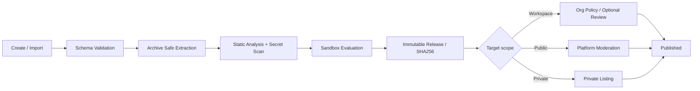

# SKILL_REGISTRY_SPEC — Skill 包、版本、分发、下架与演化

> 状态：Draft v0.1；目标是兼容 Agent Skills 的可移植注册表，而不是平台私有 Prompt 仓库。

## 0. 本文档边界
- **回答**：Skill 如何打包、验证、安装、检索、发布、下架、恢复和被 Fork。
- **约束来源**：[PRD](PRODUCT_PRD.md)、[Security](SECURITY_MODEL.md)；物理表在 [Data](DATA_MODEL.md)。
- **不回答**：工具执行调度（Runtime）、组织级 RBAC 细节（Security）。

## 1. 领域对象与不变量
| 对象 | 含义 | 关键不变量 |
| --- | --- | --- |
| Skill | 长期身份和所有权 | Skill ID 不随名称改动变化 |
| Draft | 可编辑草稿 | 可以改动，不可作为公开安装版本 |
| Release | 固定版本的签名/摘要产物 | 一经发布，不可修改同版本字节内容 |
| Listing | 某 release 的分发入口 | scope 与状态独立于 release |
| Installation | Workspace 中的安装记录 | 指向固定 release，不能隐式切到草稿 |
| Evaluation | 某 release 的测试结果与证据 | 必须绑定 release digest |
| Provenance | Fork / 作者 / 来源链接 | 衍生关系不能改变原作者资产 |

## 2. 目录与兼容性
推荐包结构：
```text
my-skill/
├── SKILL.md                 # Agent Skills 规范要求
├── skillstore.yaml          # 可选平台扩展（不得替代 SKILL.md）
├── references/              # 可选参考资料
├── scripts/                 # 可选代码，须经沙箱执行
├── assets/                  # 可选模板
└── tests/                   # 平台推荐的评测用例
```

最小 `SKILL.md`：
```markdown
---
name: ci-diagnostics
description: Diagnose CI failures from authorized repository logs.
---
# CI Diagnostics
Read logs, classify failure, propose a minimal verified fix.
```

`skillstore.yaml` 为平台 **扩展约定**，不是 Agent Skills 标准字段：
```yaml
schema_version: 1
categories: [developer, testing]
runtime: instruction-with-tools
compatibility:
  modes: [code]
requested_capabilities:
  - repo.read
  - sandbox.exec
network_policy: restricted
tests:
  - tests/smoke.yaml
```
**注意**：请求的 capabilities 不自动授予；发布后的来源、审核状态、安装量和可信评分由服务端保存，而不信任 YAML 自报。

## 3. 包接入与发布管线


### 必须执行的校验
- ZIP/tar 解压穿越、绝对路径、符号链接逃逸、文件炸弹、嵌套压缩、体积/数量上限。
- `SKILL.md` frontmatter 的 name/description 与格式验证。
- 密钥泄露、可疑下载/执行行为、依赖与许可证申明检查。
- scripts/ 对应的沙箱测试；未能测试的情况显式标记 NOT_RUN。
- 同一 `skill_id + version` 不能指向不同内容摘要。

## 4. Release 与 Listing 双状态机
### 草稿构建 → 不可变 Release
```text
Draft / Build Job: DRAFT -> VALIDATING -> READY -> RELEASED（写入 skill_releases）
                                  ↘ FAILED
Released Asset:    VALIDATED -> QUARANTINED / REVOKED
```
第一行是**构建工作流**，不是 `skill_releases` 行的状态。只有通过校验的包才能插入不可变 Release；入库后由独立 `security_status` 记录安全处置，不得改写版本文件或 digest。

### Listing
```text
PRIVATE_PUBLISHED
WORKSPACE_PENDING -> WORKSPACE_PUBLISHED -> UNLISTED
PUBLIC_PENDING   -> PUBLIC_PUBLISHED   -> UNLISTED
PUBLIC_PENDING   -> REJECTED
PUBLISHED/UNLISTED -> SUSPENDED（平台风险处置）
UNLISTED -> PENDING_REVIEW / PUBLISHED（受发布策略限制）
```
实现时用 `scope=private|workspace|public` 与 `status=pending_review|published|rejected|unlisted|suspended` 两列表示，不把组合状态硬编码为单枚举。

## 5. 发布/下架语义（强制精确定义）
| 操作 | 发起者 | 对目录 | 对新安装 | 对现有安装 | 对执行 |
| --- | --- | --- | --- | --- | --- |
| 私人发布 | 所有者 | 本人可见 | 仅本人 | 不影响其他用户 | 受 grant 约束 |
| 团队发布 | 所有者、组织审批 | 组织可见 | 组织按策略允许 | 保留原已安装版本 | 受 grant 约束 |
| 公开发布 | 创作者申请、平台审批 | 全网可见 | 按平台策略允许 | 记录固定 release | 受 grant 约束 |
| `unlist` | 创作者（有权范围内） | 不再展示 | 禁止新增 | 默认保留 | 维持原有效授权 |
| `suspend` | 平台/安全管理员 | 不可见或风险提示 | 禁止 | 标记受影响 | 禁止受影响 release 执行 |
| 个人卸载 | 安装者 | 不变 | 不变 | 仅本 workspace 删除关联 | 当前空间停止调用 |
| `revoke release` | 安全治理 | 禁止引用 | 禁止 | 风险提示 | 强制阻断 |

未来付费 Skill 必须另外定义退款、存续许可及安全撤销优先级；MVP 不实现付费权益。

## 6. 安装与升级
- `install(workspace_id, release_id)`：先检查 Listing、政策、兼容性；写 installation 并锁定 digest。
- `enable/disable`：只影响本工作空间激活状态。
- `grant()`：独立授权流程；安装不能授予敏感工具权限。
- `upgrade()`：显示新版本 Diff、权限变更和评测状态；**默认不自动提升权限**。
- `rollback()`：仅可选可获取、未 revoked 的旧 release；对历史安装不静默切版本。

## 7. 搜索和排名
1. 硬过滤：当前 scope 权限、listing 可见、客户端兼容、资产未 revoked。
2. 召回：标题/描述/标签关键词（初期 PostgreSQL FTS）+ 可选 embedding。
3. 重排：意图匹配、质量评测、可解释的使用反馈和近期维护情况。
4. 结果 UI 展示：作者、来源、版本、权限、兼容模式、测试证据与更新时间。
5. 不把安装量作为可信度替代指标；评分、评论可能被操纵。

## 8. API 草案
```text
POST   /api/v1/skills                         # 创建 Skill
POST   /api/v1/skills/{skill_id}/drafts        # 保存草稿
POST   /api/v1/skills/{skill_id}/releases      # 验证并生成不可变版本
GET    /api/v1/skills/{skill_id}/releases
POST   /api/v1/skills/{skill_id}/listings      # 申请发布到某 scope
POST   /api/v1/listings/{listing_id}/unlist
POST   /api/v1/listings/{listing_id}/restore
POST   /api/v1/skills/{skill_id}/fork
POST   /api/v1/workspaces/{workspace_id}/installations
PATCH  /api/v1/workspaces/{workspace_id}/installations/{id}
GET    /api/v1/skills/search
```
每个写接口需要授权、幂等键、审计事件；高风险操作应体现 actor 与 reason。

## 9. 自动创建与质量测试
- 从 Run 生成 Skill 时只保留可复用、去敏化的操作模式，不复制原始私人文档或密钥。
- 至少生成 1 个正例、1 个负例和 1 个未授权操作用例。
- 评测与发布内容 digest 绑定；代码或配置变化后必须重新评测。
- 自动触发模型：标注意图数据集 → precision/recall 和危险误触发率 → 上线门禁。

## 10. 验收和负面测试
- [ ] 公开未经批准的 Release，返回 403 或 409，不可能进入可搜索状态。
- [ ] 同版本上传不同 digest，冲突且不覆盖旧版本。
- [ ] 创作者 Unlist 后禁止新安装，老安装仍可读取历史引用（除非 revoked）。
- [ ] 平台 Suspend / Revoke 后，受影响 release 下一次执行被网关阻断。
- [ ] 安装者不能修改 Skill 原作者的 Release。
- [ ] 私有 Skill 不能被跨租户 search、install 或直接通过 URL 读取。
- [ ] 任意解压穿越、压缩炸弹等异常包均拒绝。

## 11. MVP / 后续边界
- P1：私人 Skill、验证发布、安装锁定、基本发现。
- P2：公共审核、组织内分享（可限单团队）、主动下架、治理冻结。
- P3：CLI、Fork、组织策略、GitHub 来源同步、作者统计。
- 后续：付费、依赖解析器、信誉积分、跨 Agent 自动兼容测试。

## 参考
- Agent Skills 官方规范：https://agentskills.io/specification
- MCP 规范：https://modelcontextprotocol.io/specification/2026-07-28

## 12. 本地优先 Skill Store（新增）

完整交互与部署规范见 [Self-hosted Workspace](SELF_HOSTED_WORKSPACE_ARCHITECTURE.md)。

- Registry 至少包括 **Bundled / Local / Optional Remote** 三个来源；Docker 首次启动即使断网也能浏览内置技能。
- 普通用户在 Client 侧边栏进入 Store：Explore / Installed / My Skills。创建、编辑、安装、升级、卸载都是普通用户能力；治理后台保留安全处置。
- 安装记录应与用户/Workspace 绑定，安装时必须固定不可变 Release，权限申请需要运行时授权；安装动作不等于可以执行任意脚本。
- 公共远程 Registry 必须可关闭，并在每次安装前校验来源、版本与内容哈希；本地离线安装、取消安装和重启后的安装状态必须有 E2E。
- 本地“卸载”不得误触发公共 Listing 下架，本地“禁用”不得改写包资产所有权。

## 13. Skill Registry 与 Pi Skills 的集成契约

参考 [PI_AGENT_INTEGRATION.md](PI_AGENT_INTEGRATION.md)。**Agent Skills 文件格式/按需加载语义与 Pi 兼容，但商店资产所有权归我们。**

- Store 将安装限定为明确的 Release digest；在 Pi 创建/重载 Session 时通过受控 `ResourceLoader` 注入本次可用的 Skill 清单。
- 以 Pi 的 name/description progressive disclosure 作为底层加载机制；用户可通过显式 Skill 指令触发，但结果需经过我们的任务质量评测。
- 不得未经信任审核就把上传包作为可执行 Pi Extension 或 Pi package 安装；Skill 内脚本也必须受隔离与 Tool Gateway 限制。
- Pi 的自动发现来自当前目录和用户目录；Web 产品不能仅依赖它完成跨用户隔离。使用平台受控目录、白名单或自定义 Loader，在每次 Run 记录 Skill ID、Release、SHA-256。
- 同一会话中安装/停用/升级 Skill 时，重新生成可用资源快照并明确向用户提示何时生效；不可改变正在执行 Run 的固定资源版本。
